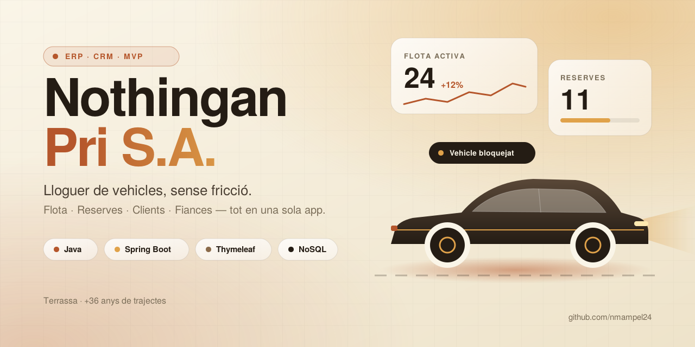

# Nothingan Pri – ERP/CRM per a lloguer de vehicles


Producte mínim viable (MVP) d'una aplicació web d'ERP i CRM per a **Nothingan Pri S.A.**, empresa familiar de lloguer de vehicles a Terrassa. L'aplicació cobreix tot el procés de negoci: des de l'alta del client fins al retorn del vehicle i el càlcul de la fiança.

## 👥 Equip
- Nil Mampel – responsable de la gestió de vehicles
- Zohaib Zaib – responsable de la gestió d'usuaris
- Ruben García - responsable de la gestió de reserves

## 🛠 Tecnologies
Java · Spring Boot · Thymeleaf · Maven · base de dades relacional · MongoDB · JUnit 5 · Git

## ✨ Funcionalitats
- Alta de clients (per web o per un agent), amb validació de l'administrador si és per web
- Clients premium amb descompte a la fiança
- Gestió de vehicles: alta, baixa, activació, desactivació, lliurament i retorn
- Reserves amb bloqueig automàtic del vehicle
- Lliurament i retorn amb fotos i observacions d'incidències
- Càlcul automàtic de la retenció de fiança
- Informes de reserves filtrables
- Aplicació multiusuari amb permisos per rol (administrador, agent i client)
- Interfície responsive, accessible i en català

## 🗄️ Arquitectura de dades
- **Base de dades relacional:** clients, vehicles, reserves i fiances.
- **MongoDB (NoSQL):** fotos i documents (DNI, llicència, lliuraments, retorns, incidències), notificacions, logs del sistema i preferències de client. La base relacional només guarda referències a aquests documents.

## 📄 Documentació
- [Memòria del projecte](docs/memoria.pdf)
- [Diagrama de base de dades](docs/DataBase/)

## Com executar-lo

### Requisits
- Java (JDK) i Maven
- MySQL 8 (BD `projecte1_equip5`)
- MongoDB (BD `reserves_docs`)

### Passos
1. Clona el repositori i entra a la carpeta del projecte:
   ```bash
   git clone https://github.com/nmampel24/nothingan-pri-erp-crm.git
   cd nothingan-pri-erp-crm/code
   ```
2. Copia `src/main/resources/application.properties.example` a `src/main/resources/application.properties` i omple les teves dades de connexió (usuari i contrasenya de MySQL, i URI de MongoDB).
3. Arrenca MySQL i MongoDB. Si vols partir d'una BD buida, l'aplicació crea les taules i carrega dades de prova en arrencar.
4. Executa:
   ```bash
   mvn spring-boot:run
   ```

Les dades de prova es carreguen automàticament. Els usuaris de prova (agents i clients) tenen la contrasenya `Prova1234`.
